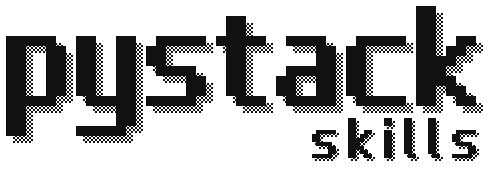

# PyStack Skills

<picture>
  <source media="(prefers-color-scheme: dark)" srcset="assets/logo-dark.svg">
  
</picture>

Opinionated agent skills for typed Python backend services.

PyStack is a repo-owned skill set for AI coding agents such as Claude Code, Codex, Cursor, OpenCode, and GitHub Copilot. It encodes one practical backend shape for a common modern Python service stack so agents, reviewers, and teams know what kind of code to expect.

If your style differs, install the subset that matches yours and skip the rest.

## Why This Exists

Style guides are written for humans. AI coding agents need smaller, triggerable rules that load only when relevant: how repos behave, where transactions live, when Pydantic is allowed, how external clients retry, and what tests should prove.

Generic prompts like "follow DDD" or "use clean architecture" help a little, but they leave too much room for agents to drift. In real codebases that drift shows up as repos committing their own transactions, routes growing business logic, services becoming god classes, Pydantic leaking into persistence, SQLAlchemy tests using mocks, and retries duplicating side effects.

PyStack turns team taste into repo-owned, reviewable guidance. The goal is not to make every prompt longer. The goal is to define the relationships between the pieces once so agents can do better work without every request restating the architecture.

The useful part is that this guidance is yours. Fork it, delete what you disagree with, rewrite the trade-offs, add your own examples, and keep the resulting agent behavior visible in the same place as the code it shapes.

## Architecture Stance

PyStack is pragmatic tactical DDD for one Python backend service.

- SQLAlchemy models carry aggregate behavior by default.
- Pydantic stays at boundaries: API schemas, commands, responses, config, and external payloads.
- Repositories load and save aggregates; they do not own transactions.
- Top-level application services own write transactions with `async with session.begin()`.
- Pure domain classes are opt-in for invariant-dense systems where mapper cost pays back.
- Domain services and policies are extraction tools, not a mandatory layer.
- External systems are wrapped in clients with explicit retry/error behavior.
- Tests use real Postgres for persistence and purpose-built doubles for external systems.
- Protocols/interfaces are added when they earn their keep, not for every repo/client by default.

Influences and references:

- [Cosmic Python](https://www.cosmicpython.com/)
- [Python Patterns](https://python-patterns.guide/)
- [Domain-Driven Design Reference by Eric Evans](https://www.domainlanguage.com/ddd/reference/)
- Martin Fowler on [testing](https://martinfowler.com/testing/)
- Martin Fowler on [mocks vs stubs](https://martinfowler.com/articles/mocksArentStubs.html)
- [Python documentation](https://docs.python.org/3/)
- [FastAPI documentation](https://fastapi.tiangolo.com/)
- [Pydantic documentation](https://docs.pydantic.dev/)
- [SQLAlchemy documentation](https://docs.sqlalchemy.org/)

See [ARCHITECTURE.md](ARCHITECTURE.md) for the locked decisions and trade-offs.

## DDD Mapping

Strategic DDD concepts like context maps and upstream/downstream relationships matter when designing multiple services or team boundaries. Inside one service, the useful surface is usually tactical: aggregates, value objects, repositories, application services, invariants, events, transactions, and adapters.

| Traditional concept | PyStack representation | Notes |
|---|---|---|
| Entity | SQLAlchemy model with identity and lifecycle in `app/models/` | The default domain object is the SA model. |
| Value Object | Frozen dataclass or `NewType` | Use for `Money`, `EmailAddress`, IDs, and other invariant-bearing values. |
| Aggregate | One SA model root plus owned child entities | Methods enforce invariants and state transitions. |
| Aggregate Root | One model file and one repo file per root | Children like `OrderLine` live with `Order`; external code mutates through the root. |
| Repository | `app/repos/<aggregate>.py` | Repos use `AsyncSession`; they do not `commit()` or `begin()`. |
| Unit of Work | `AsyncSession` | A custom UoW is optional only when it owns extra behavior such as outbox/event collection. |
| Application Service | `app/services/<use_case_area>.py` | Orchestrates repos, clients, transactions, outbox writes, and returns Pydantic schemas. |
| Domain Service / Policy | Small sync function or frozen dataclass | Extract only when a pure business decision spans multiple objects or would create a god service. |
| Factory | `@classmethod new/from_X` or schema `to_X` method | Separate factory classes are discouraged unless construction has real state or dependencies. |
| Domain Event | Frozen dataclass in `app/events/` | Opt-in with `python-message-bus-outbox`; events are past-tense facts like `OrderPlaced`. |
| Message Bus | `app/common/message_bus.py` plus handlers | Opt-in for local decoupling or event-driven services. |
| Outbox | `app/outbox/` table and dispatcher | Opt-in for at-least-once cross-process delivery after DB commit. |
| Anti-Corruption Layer | External clients + schemas | Third-party payloads are translated at client/schema boundaries. |
| Port | Concrete repo/client by default; `Protocol` only when useful | Add a port when there are multiple implementations or a real substitution boundary. |
| Adapter | `app/api/`, `app/consumers/`, `app/repos/`, `app/clients/`, `app/outbox/` | Uses conventional FastAPI names instead of academic `inbound/` / `outbound/` directories. |

## Skills

PyStack contains 12 skills in three tiers. Each tier is also an installable plugin. The `description` field in each skill's frontmatter tells the agent when to load it.

| Tier / plugin | Skill | Purpose |
|---|---|---|
| `python` | `python-typing-idioms` | `Protocol`, `Self`, `NewType`, PEP 695, typed constructors |
| `python` | `python-value-objects` | Frozen dataclass value objects and ID types |
| `python` | `python-stdlib-idioms` | Generators, `itertools`, async iteration, tree composition |
| `python` | `python-antipatterns-cheatsheet` | Singleton and Factory redirects for Python |
| `service` | `python-fastapi-sa-app-setup` | App layout, config, lifespan, deps, middleware, exception handlers |
| `service` | `python-aggregate-and-repo` | SQLAlchemy model with behavior, aggregate boundaries, repositories, value-object mapping |
| `service` | `python-service-and-schema-cohesion` | Application services, commands, schemas, transaction ownership |
| `service` | `python-external-client` | HTTP clients, retry policy, error mapping, fake transports |
| `service` | `python-structlog-logging` | Structlog setup and request correlation |
| `service` | `python-test-pyramid` | Real Postgres tests, API tests, external doubles |
| `opt-in` | `python-pure-domain-layer` | Separate pure domain classes when invariants justify mapper cost |
| `opt-in` | `python-message-bus-outbox` | Domain events, in-process bus, outbox, idempotent handlers |

## Install

Any agent that reads [Agent Skills](https://agentskills.io/specification) (Claude Code, Codex, Cursor, OpenCode, GitHub Copilot, ...):

```bash
npx skills add denyszhak/pystack-skills
```

Claude Code, as plugins (one per tier):

```text
/plugin marketplace add denyszhak/pystack-skills
/plugin install pystack-service@pystack-skills
```

Or, without Node, symlink from a clone:

```bash
git clone https://github.com/denyszhak/pystack-skills && cd pystack-skills
./install.sh claude            # ~/.claude/skills (Claude Code)
./install.sh agents            # ~/.agents/skills (Codex, Cursor, OpenCode, Copilot, ...)
```

[INSTALL.md](INSTALL.md) covers where each agent looks, installing a subset, avoiding duplicate skills, and upgrading from the old installer.

## Skill Format

Each skill is a directory under `skills/` that follows the [Agent Skills specification](https://agentskills.io/specification):

```text
skills/python-typing-idioms/
  SKILL.md            # YAML frontmatter + markdown body
  examples/           # Python examples the skill points to (optional)
  references/         # longer supplementary docs, loaded on demand (optional)
```

Frontmatter uses only fields from the spec, so every client accepts it:

```yaml
---
name: python-typing-idioms          # matches the directory; lowercase + hyphens, ≤64 chars
description: |                      # ≤1024 chars: when to use, triggers, what it encodes, when not to
  Use when ... Triggers ... Encodes ...
  Do NOT use for: ...
license: MIT
compatibility: Python 3.12+.
metadata:
  tier: python                      # python | service | opt-in — read by install.sh
---
```

When you add a skill, add it to the matching plugin's `skills` list in [`.claude-plugin/marketplace.json`](.claude-plugin/marketplace.json) too. Check skills against the spec with the reference validator:

```bash
uvx --from skills-ref agentskills validate skills/python-typing-idioms
```

## Target Stack

PyStack is not a framework, starter template, or claim about all Python. It is versioned guidance for this service stack:

| Layer | Choice |
|---|---|
| Language | Python 3.12+ |
| HTTP API | FastAPI |
| Schemas and settings | Pydantic v2 |
| Persistence | SQLAlchemy 2.x async |
| Database | PostgreSQL |
| Tests | pytest, real Postgres, protocol-level external doubles |
| Clients and logging | httpx, structlog |
| Tooling | uv, ruff, ty |

## License

MIT. See [LICENSE](LICENSE).
